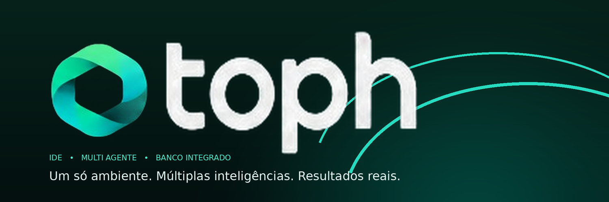

# Toph



**Toph** is a self-hosted workbench for machines you control. It brings code, databases, AI sessions and web apps into one place, with a workspace that feels close to VS Code and runs in your browser, on the desktop, or as a remote Android client.

Toph is built for people who keep their own services, repositories and data on machines they control. There is no hosted account, no vendor backend and no telemetry.

## Public pages

- `/` — redirects to the workbench.
- `/app` — the workbench (sign-in required).

The installed server does not serve the landing page or documentation. The landing source lives in `apps/landing/` for separate local work only; it is not part of the installer, release or backend bundle.

## What it does

- Browse and edit project files with tabs, a file tree, unified search and live Git status. Source control changes and branch switching live in the Git modal.
- Run a real terminal attached to the server, with a draggable terminal height and working keyboard input.
- Open repositories from a searchable repository picker; names are derived automatically.
- Open projects as top-level tabs. Closing a project tab stops its terminal sessions and child processes without deleting the project.
- Use the real VS Code Material Icon Theme, stage/unstage/discard/commit and branch creation from configurable patterns in the Git modal, side-by-side diff tabs and Git blame for the current editor line.
- Search matches both file names and file content automatically with debounce, without pressing Enter.
- Ctrl+P opens and focuses the same unified search, while inline Git blame and an OpenCode-style conversation view provide reasoning, tool cards, subagents and Markdown.
- Edit SQL table rows with primary-key safety.
- Connect to PostgreSQL, MySQL/MariaDB, SQLite, SQL Server, Oracle, ClickHouse, Cassandra, MongoDB, Redis, Elasticsearch and Neo4j, inspect schemas, run queries and inspect results.
- Talk to OpenCode, OpenAI-compatible endpoints, Codex, Claude or Ollama from the Agent tab without leaving the workbench.
- Configure the AI URL, API key and model in Settings → AI; API keys are encrypted at rest.
- OpenCode users can sign in to OpenCode Console or connect provider API keys from Settings → AI → Entrar / conectar. A local OpenCode server is detected automatically from `~/.config/opencode/service.json`; use `TOPH_OPENCODE_URL` and `TOPH_OPENCODE_AUTH` for remote servers.
- Enable editor autocomplete backed by the configured AI provider.
- Add server folders as workspace roots in Settings → Workspace, without Docker bind mounts.
- Keep self-hosted and external web apps in their own tabs, including pages that block iframes, through a server-side preview proxy.
- Switch between projects without losing the state of the current one.
- Use the same backend from the browser, desktop app and Tauri Android client.
- Choose a pet at login; it lives in the avatar corner or roams the screen, and grows every few commits.
- Get an in-app toast when a new release is available; the button updates the server and reloads connected web clients.
- Receive in-app AI response notifications and Android push notifications through Firebase Cloud Messaging, including when the app is closed.
- Download the next desktop installer directly from the update toast, with checksum verification. Windows uses the MSI installer.
- Use a native-titlebar-only desktop shell with a VS Code-style header containing menus, project and branch selectors, editor status, and an agent rail.
- Personalize the web app with light/dark themes, the Toph amber accent, sidebar width, editor and terminal typography, tab styles, and three global icon sets: Material, Phosphor Fill and Remix Fill. The icon choice applies to the entire interface and the file tree. Drag the sidebar, agent dock and terminal edges to resize them.

## Repository layout

```text
apps/web/        React workbench application
apps/landing/    public landing page
apps/client/    Tauri desktop and Android client
services/toph/   Rust API, workspace, terminals, databases, OpenCode proxy
packages/brand/  shared brand assets and BrandMark
packages/ui/     shared React UI primitives
deploy/          Docker Compose
```

The backend embeds only the application. The landing page is never installed, embedded, released or served by the Toph server.

## Architecture

```text
Browser (React)                     Tauri (desktop + Android)
        │                                    │
        └──────────── HTTPS / WSS ───────────┘
                          │
                    toph (Rust)
        ├── auth and sessions
        ├── projects and workspace files
        ├── terminal (PTY over WebSocket)
        ├── database gateway
        ├── OpenCode proxy
        └── web target registry
                          │
        repositories · PostgreSQL · SQLite · MySQL · OpenCode
```

The Rust server is the only component that touches repositories, database credentials and shells. Clients are thin: they render tabs and stream data. The browser build is embedded in the Rust binary; desktop and Android clients use the same API. Desktop local mode embeds the Rust server in the Tauri process itself, so no separate server process is started.

## Security

- Passwords use Argon2id; sessions are stored as token hashes.
- Browser sessions use `HttpOnly`, `Secure` and `SameSite=Strict` cookies when `TOPH_SECURE_COOKIES=true`.
- Cookie-authenticated mutations require a double-submit CSRF token.
- Login and API endpoints have per-client rate limits.
- `X-Forwarded-For` is only trusted from loopback or the CIDRs in `TOPH_TRUSTED_PROXIES`.
- The OpenCode proxy drops browser cookies and authorization headers before forwarding.
- API responses use `Cache-Control: no-store` and responses are protected against framing.

## Run it

### Requirements

- Rust stable (1.90+ recommended)
- Node.js 22+
- SQLite is embedded through SQLx
- Linux, macOS or a Linux container
- Docker and Docker Compose v2, optional

### Development

```sh
cp .env.example .env
cargo run --manifest-path services/toph/Cargo.toml --bin toph
```

In another terminal:

```sh
npm install
npm run dev:web
```

Landing source, separately (not part of the installable app):

```sh
npm run dev:landing
```

App: `http://localhost:5173/app/`. Landing source: `http://localhost:5174/`.

### Production build

```sh
make build
./bin/toph
```

`make build` builds `apps/web` and embeds it into the Rust binary. Open `http://127.0.0.1:8787`.

### One-command install

On a Debian/Ubuntu server or LXC:

```sh
curl -fsSL https://github.com/ferforastieri/toph/releases/latest/download/install.sh | sudo sh
```

The installer creates the `toph` user, installs the binary, creates a systemd
service, generates the first password and starts Toph on port `8787`. It also
installs the root-owned update helper used by the in-app update toast.

The server installer can also provision a development environment on the
server, where Toph's terminal and tools actually run:

```sh
curl -fsSL .../install.sh | sudo sh -s -- --components git,node,pnpm,rust,go,python
```

Use `--components all` or `--no-components`. The desktop launcher offers the
same optional tool selection for local workspaces; remote desktop, web and
mobile clients never install toolchains on the client machine.

### Releases

Every successful CI run on `main` publishes the next GitHub release
automatically. The version bump follows Conventional Commits across the commits
since the latest release:

- `fix:` — patch (`0.8.10` → `0.8.11`)
- `feat:` — small feature, minor (`0.8.10` → `0.9.0`)
- `feat!:` or `BREAKING CHANGE:` — large feature, major (`0.8.10` → `1.0.0`)
- other commit types — patch

The pipeline creates the tag, builds the server, APK and desktop installers, and
publishes the release. It never deploys to a server by itself.

Remote servers expose an update toast when a newer release exists. Clicking
**Update** writes an authenticated update request; the root-owned helper runs
the same `install.sh` release flow, checks health and rolls back on failure.

On the Android APK, the same action also asks Android's DownloadManager for the
latest signed APK. The first APK that contains this downloader must be installed
manually from the release; subsequent updates can download the next APK from the
toast. Installing the downloaded APK still requires the normal Android prompt.

### Desktop

Install the Windows or Linux package from the [latest release](https://github.com/ferforastieri/toph/releases/latest). Desktop local mode embeds the Rust Toph server and asks for a workspace folder; server mode asks only for a URL on first use and reconnects to the last server on later launches. The launcher also offers an optional development-environment installer for Git, Node.js, pnpm, Rust, Go and Python. The local backend uses the app data directory for SQLite and its generated admin password.

The desktop and Android builds share `apps/client/`; Android remains remote-only; the embedded desktop server target is not built for mobile. Windows installers use a Toph-branded WiX MSI with custom artwork and metadata.

### Docker

```sh
TOPH_WORKSPACES_HOST=/srv/workspaces docker compose -f deploy/compose.yaml up --build
```

Mount the repositories you want to expose under `/workspaces` and keep `TOPH_DATA_DIR` on a persistent volume. The container runs as UID 1000; make sure the mounted workspace is writable by that user, or adjust the Compose `user:` setting.

### Desktop and Android

Signed Android APKs are published on [GitHub Releases](https://github.com/ferforastieri/toph/releases). They are remote-only.

The Tauri client lives in `apps/client/` and builds the Windows and Linux installers from the same source. On the desktop it can connect to a Toph server or run the embedded local Rust backend. On Android it is a remote-only client: the WebView connects to the Toph server URL configured on the launcher, and no local server or terminal runs on the phone.

For Android development, install JDK 21, Android SDK 36 and NDK 28.2, then:

```sh
npm ci
cd apps/client
npm run tauri -- android init
npm run icons
npm run android:patch
npm run tauri -- android build --debug --apk --target aarch64
```

The generated Android project is not committed; `tauri android init` recreates it. Use LAN, VPN or Tailscale for the server URL; do not expose the server directly to the internet.

## Configuration

| Variable | Default | Purpose |
| --- | --- | --- |
| `TOPH_ADDR` | `127.0.0.1:8787` | HTTP listen address |
| `TOPH_DATA_DIR` | `./data` | SQLite, master key and runtime data |
| `TOPH_WORKSPACES` | `/workspaces` | Colon-separated roots that projects may use |
| `TOPH_ADMIN_PASSWORD` | generated on first run | Initial admin password |
| `TOPH_SECURE_COOKIES` | `false` | Require HTTPS for browser sessions; the installer sets `true` |
| `TOPH_TRUSTED_PROXIES` | empty | Comma-separated proxy IPs/CIDRs allowed to supply `X-Forwarded-For` |
| `TOPH_OPENCODE_URL` | `http://127.0.0.1:3005` | Fallback OpenCode server; Settings → AI overrides it. When unset, a local `~/.config/opencode/service.json` port is used |
| `TOPH_OPENCODE_AUTH` | auto-detected locally | Fallback raw `Authorization` value for OpenCode. A local service password is read from `~/.config/opencode/service.json`; set this for remote servers |
| `TOPH_FIREBASE_CREDENTIALS_FILE` | empty | Firebase service-account JSON used by the server for Android push |
| `TOPH_FIREBASE_PROJECT_ID` | service-account project | Firebase project ID for Cloud Messaging |
| `TOPH_WEB_DIR` | embedded build | Serve a web build from disk in development |
| `TOPH_UPDATE_REPO` | `ferforastieri/toph` | GitHub repository used by the in-app update check |
| `TOPH_DEV_COMPONENTS` | empty | Server installer only: `git,node,pnpm,rust,go,python`, `all`, or `none` |

## Security

Toph can read files, open shells and reach databases. Treat it as a remote administration tool:

- bind it to localhost, LAN or a VPN;
- put TLS in front of it;
- use a strong password and keep the data directory private;
- do not publish it on the public internet.

## License

MIT.

## Desktop

The client lives in `apps/client/` and uses Tauri 2. The same project builds Windows and Linux installers, with a Tauri Android target for mobile. Server mode accepts any Toph server URL; local mode embeds the Rust backend in the Tauri process, asks for a workspace folder, serves the UI on loopback, and shuts the backend down when the app exits. Windows local terminals use ConPTY; Linux uses a PTY.
