# Toph Mobile — prints de validação

Capturas reais do frontend mobile em viewport de **iPhone 14 Pro (393 × 852)**, tema escuro, com dados de demonstração.

> Build local, ainda não publicada no servidor. O servidor de produção continua na versão anterior.

## Telas

| | | |
|---|---|---|
| 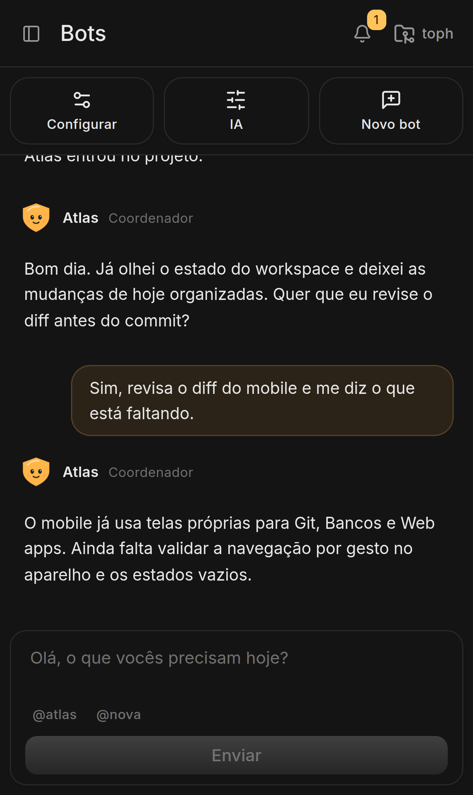<br>**Bots** — home | 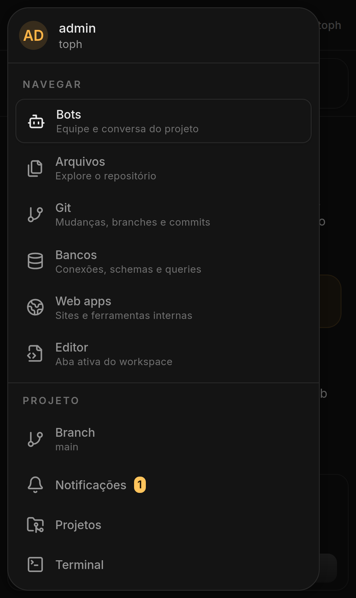<br>**Drawer** — swipe da borda | 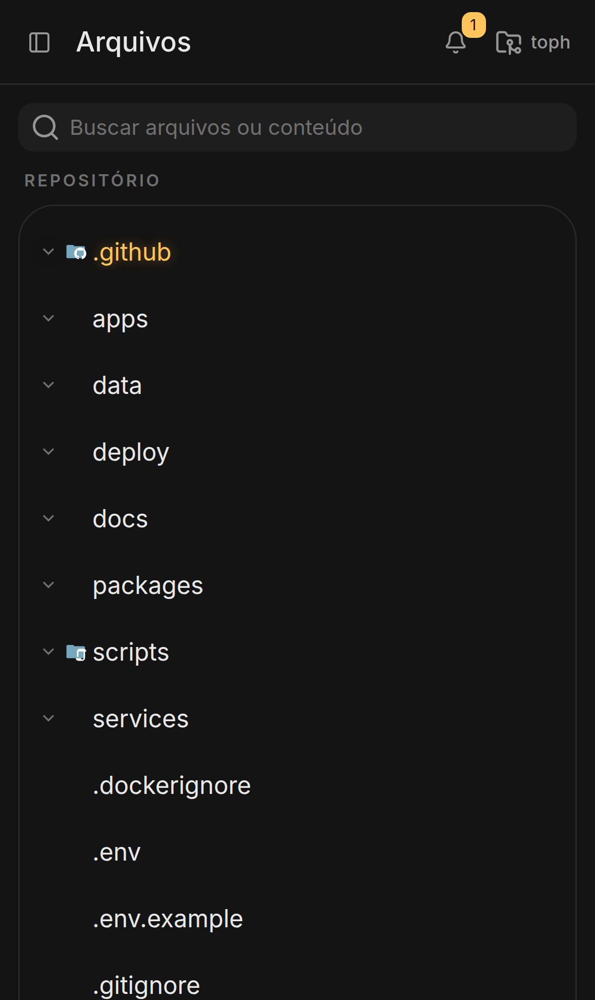<br>**Arquivos** — busca e árvore |
| 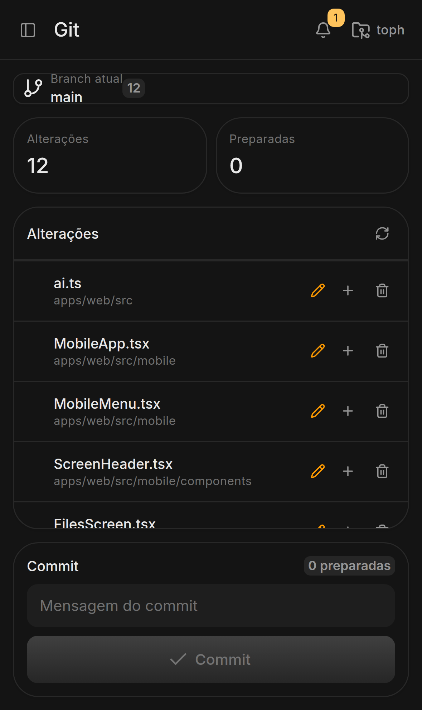<br>**Git** — alterações e commit | 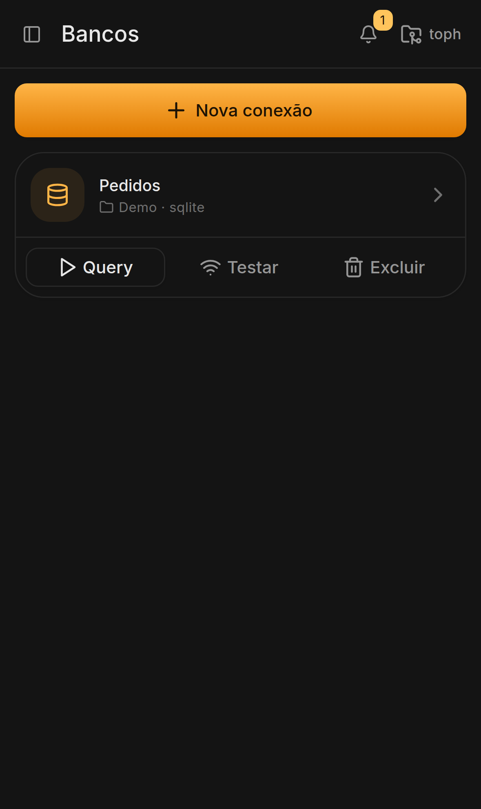<br>**Bancos** — conexões e schema | 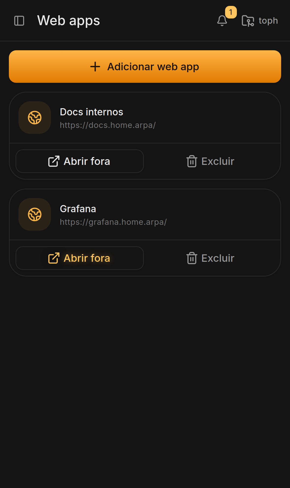<br>**Web apps** — cards |
| 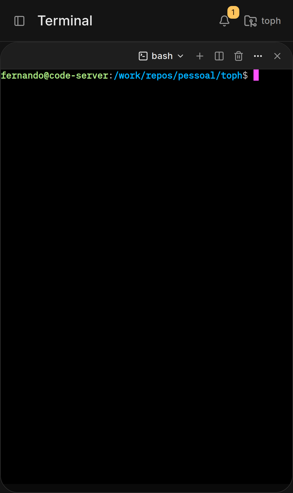<br>**Terminal** — tela cheia | 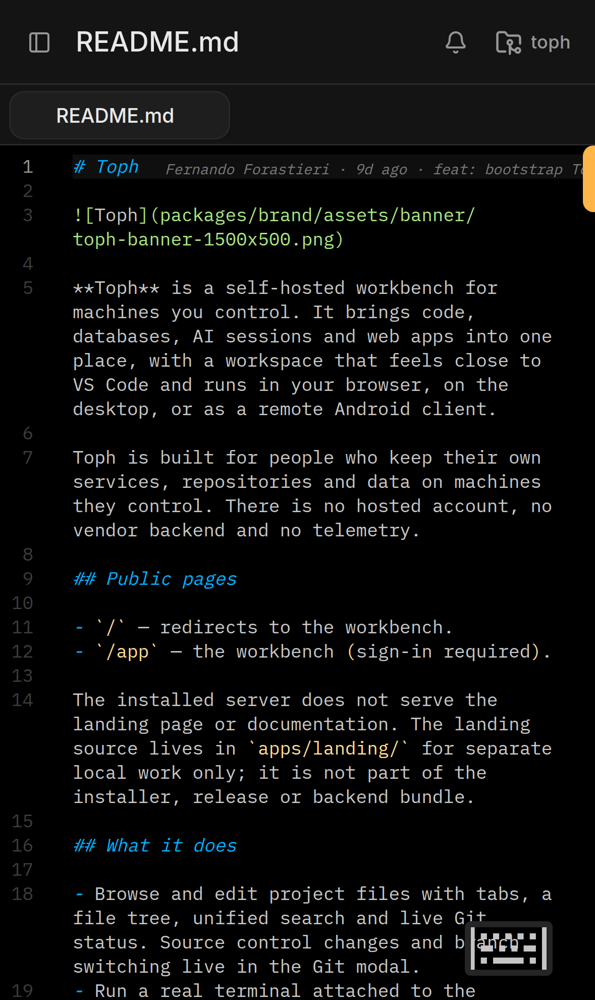<br>**Editor** — arquivo aberto | 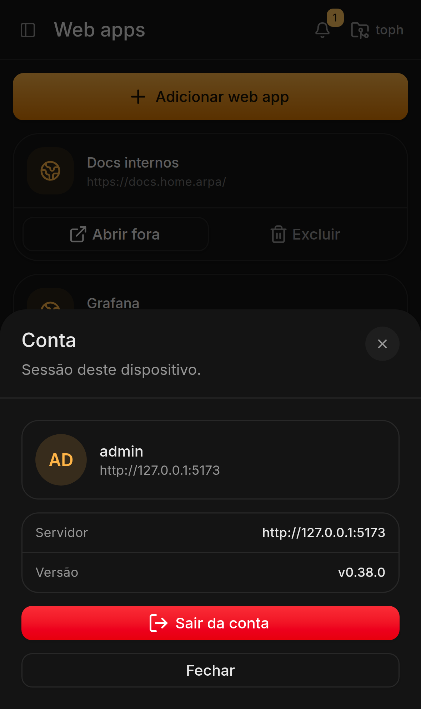<br>**Conta** — avatar/account |
| 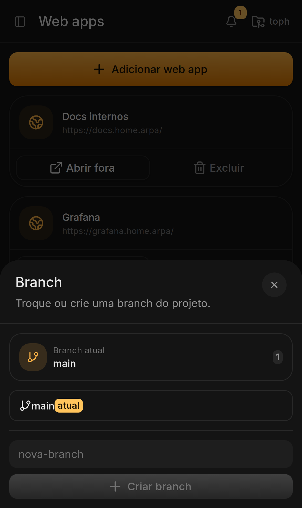<br>**Branch** — troca e criação | 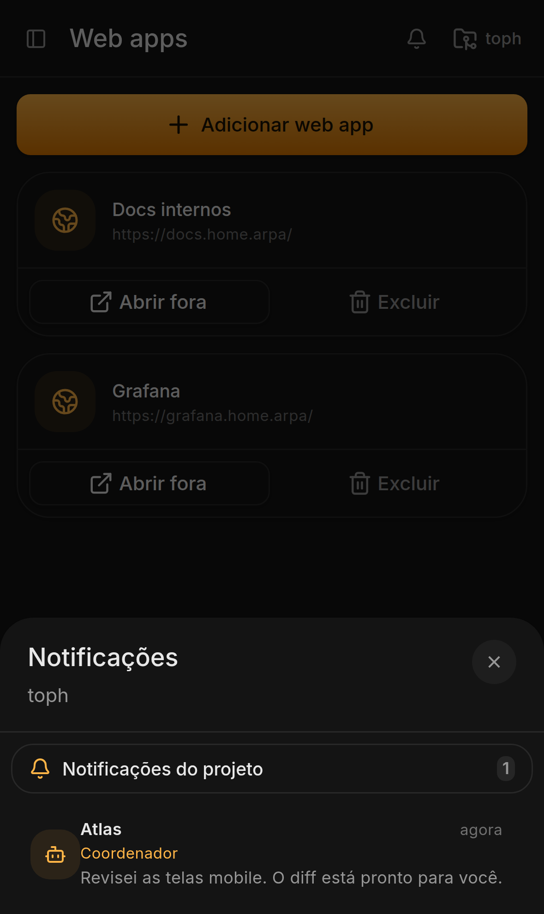<br>**Notificações** — sheet | 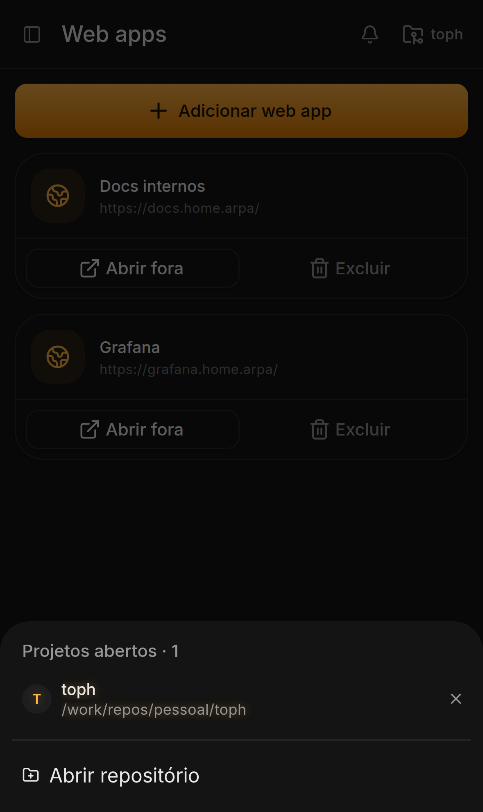<br>**Projetos** — seletor compartilhado |

## Galeria local

Abra `index.html` com qualquer servidor estático, por exemplo:

```bash
cd docs/mobile-screenshots
python3 -m http.server 8899
```

Depois acesse `http://localhost:8899/`.
